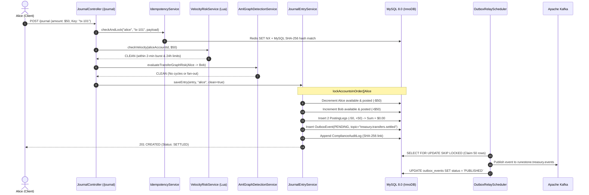
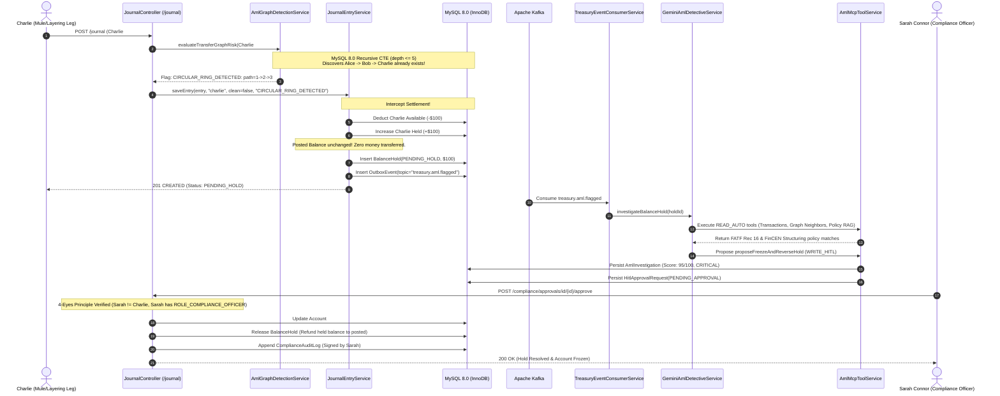

# RuneStone Bank: Enterprise Treasury Ledger & Autonomous AML Compliance Platform
## Complete Staff Engineer Architecture Walkthrough, Codebase Map, and Testing Guide

---

## SECTION 1: THE "EXPLAIN LIKE I'M IN AN INTERVIEW" OVERVIEW

### 1. What Real-World Problem Does This Application Solve?
In financial services, money movements must satisfy two non-negotiable requirements:
1. **Mathematical Ledger Integrity**: You cannot lose track of cents, allow negative double-spending, or allow race conditions when thousands of users transfer funds simultaneously.
2. **Regulatory Anti-Money Laundering (AML) Compliance**: Financial institutions are legally mandated (under FinCEN, FATF, and central banking rules) to intercept illicit money movement (e.g., circular round-tripping, smurfing/structuring, and mule networks) **in real time**, not weeks after the funds have already left the bank.

Traditional banking architectures separate these two concerns: the core ledger moves money blindly, and a batch job inspects logs hours or days later. **RuneStone Bank merges high-throughput double-entry accounting with real-time recursive graph fraud detection and autonomous AI investigations.**

---

### 2. Retail Banking App vs. Enterprise Treasury & AML Compliance Platform

| Dimension | Normal Retail Banking App (e.g., Venmo, Revolut) | RuneStone Enterprise Treasury & AML Platform |
| :--- | :--- | :--- |
| **Balance Model** | Single balance column: `balance = balance - $50`. Vulnerable to race conditions. | **3-Bucket Ledger**: `posted_balance = available_balance + held_balance`. Funds can be encumbered without debiting book value. |
| **Ledger Model** | Single transaction row (`UPDATE accounts SET balance = balance - 50`). | **Strict Double-Entry General Ledger**: Paired immutable `PostingLeg` entries (`-DEBIT` and `+CREDIT`) where $\sum = \$0.0000$. |
| **Concurrency Control**| Optimistic version locking, resulting in retry storms and failed transfers. | **Deadlock-Free Pessimistic Ordering**: Sorting account IDs ascending (`lockAccountsInOrder`) with row-level `PESSIMISTIC_WRITE`. |
| **Fraud Detection** | Basic rule filters (e.g., single transfer $> \$10,000$). | **5-Hop Recursive CTE Graph Analysis**: Detects multi-hop circular layering rings and fan-out/fan-in mule structuring in MySQL. |
| **AML Investigation**| Manual review by compliance analysts days later. | **Autonomous Gemini Detective via MCP 2.0**: Reads graph context, cites vector RAG legal policies, and prepares action dossiers. |
| **Execution Governance**| Automation runs unchecked or manual tickets sit in queues. | **4-Eyes Principle Human-in-the-Loop (HITL)**: High-impact actions (account freezes) require dual-control sign-off with self-approval blocks (`403 Forbidden`). |
| **Audit Trail** | Modifiable audit tables in SQL. | **Tamper-Evident SHA-256 Hash Chain**: Each audit record hashes its payload plus the previous row's hash. |

---

### 3. Life of a Request: Two Real-World Scenarios

#### Scenario A: Clean $50 Transfer from Alice to Bob (`SETTLED`)


#### Scenario B: Suspicious Circular Transfer (`Alice -> Bob -> Charlie -> Alice`)


---

## SECTION 2: VERIFIED TECH STACK & WHERE EACH TECH IS USED IN CODE

| Technology | Implementation Files / Classes in Code | Why It Is Used (Exact Bug or Vulnerability Prevented) |
| :--- | :--- | :--- |
| **Java 21 (LTS)** | `server/src/main/java/com/runestone/treasury/` | Virtual threads (`newVirtualThreadPerTaskExecutor`) prevent thread exhaustion under 100+ concurrent transfer requests. |
| **Spring Boot 3.3.4** | `com.runestone.treasury.config.SpringSecurity`<br/>`com.runestone.treasury.controller.*` | Standardized REST microservice architecture, connection pooling, and declarative `@Transactional` management. |
| **MySQL 8.0 (InnoDB)** | `PostingLegRepositoryImpl.java`<br/>`TreasuryAccountRepositoryImpl.java` | **Recursive CTEs** (`WITH RECURSIVE`) enable 5-hop graph cycle detection in the DB engine; `SELECT ... FOR UPDATE` prevents concurrent balance reads. |
| **Flyway Database Migrations** | `server/src/main/resources/db/migration/`<br/>`V1` through `V5` | Prevents database schema drift across environments; guarantees deterministic table generation and pre-seeded vector RAG policy chunks. |
| **Redis 7.2 + Atomic Lua** | `IdempotencyService.java`<br/>`transfer_velocity_window.lua` | **Eliminates race conditions in rate limiting.** Lua script executes atomically in Redis memory, preventing two rapid requests from bypassing the 2-minute burst velocity window. |
| **Apache Kafka (Confluent 7.6.1)** | `OutboxRelayScheduler.java`<br/>`TreasuryEventConsumerService.java` | Asynchronous decoupled messaging. Isolates core banking ledger latency from AI detective analysis; provides durable replayable message streams. |
| **Google Gemini API + Cosine RAG** | `GeminiAmlDetectiveService.java`<br/>`AmlPolicyRagService.java` | Autonomous contextual reasoning over money trails; matches regulatory legal texts (FinCEN/FATF) using normalized float vector cosine similarity. |
| **Model Context Protocol (MCP 2.0)** | `AmlMcpToolService.java`<br/>`mcp_tool_invocations` table | **Prevents rogue autonomous agent execution.** Enforces rigid authorization tiers (`READ_AUTO` executes immediately; `WRITE_HITL` halts until human sign-off). |
| **React 19 + Tailwind CSS** | `client/src/App.jsx`<br/>`client/src/pages/ComplianceCommandCenter.jsx`<br/>`client/src/components/AmlGraphVisualizer.jsx` | Pure JavaScript (ES6 JSX) SPA with responsive brutalist UI; renders real-time animated SVG sub-graphs and multi-bucket balance visualizers. |
| **JUnit 5 + Mockito** | `server/src/test/java/com/runestone/treasury/` | Verifies system invariants via unit tests and 100-thread concurrent stress testing (`DoubleEntryConcurrencyTests.java`). |

---

## SECTION 3: FEATURE-BY-FEATURE CODEBASE MAP

### 1. Immutable Double-Entry Ledger & Three Balance Buckets
* **Plain English**: Every account tracks three numbers: Posted (total book value), Available (spendable cash), and Held (escrowed by AML). Money cannot simply be "subtracted"; every transfer writes two immutable posting legs (a negative debit and a positive credit). The sum of all legs in a transaction must mathematically equal zero.
* **Backend Code**:
  - Controller: [`JournalEntryController.java`](file:///Users/saimandsroy/Downloads/RuneStone-Bank-main/server/src/main/java/com/runestone/treasury/controller/JournalEntryController.java) (`POST /journal`)
  - Service: [`JournalEntryService.java`](file:///Users/saimandsroy/Downloads/RuneStone-Bank-main/server/src/main/java/com/runestone/treasury/service/JournalEntryService.java)
  - Repository: [`PostingLegRepository.java`](file:///Users/saimandsroy/Downloads/RuneStone-Bank-main/server/src/main/java/com/runestone/treasury/repository/PostingLegRepository.java), [`TreasuryAccountRepository.java`](file:///Users/saimandsroy/Downloads/RuneStone-Bank-main/server/src/main/java/com/runestone/treasury/repository/TreasuryAccountRepository.java)
  - MySQL Tables: `treasury_accounts`, `journal_entries`, `posting_legs`
* **Frontend UI**:
  - Component: [`TotalBalance.jsx`](file:///Users/saimandsroy/Downloads/RuneStone-Bank-main/client/src/components/dashboard/TotalBalance.jsx), [`DoubleEntryBucketsCard.jsx`](file:///Users/saimandsroy/Downloads/RuneStone-Bank-main/client/src/components/DoubleEntryBucketsCard.jsx), [`TransactionsPage.jsx`](file:///Users/saimandsroy/Downloads/RuneStone-Bank-main/client/src/pages/TransactionsPage.jsx) (Displays $\Sigma = \$0.00$ badge).

### 2. Deadlock-Free Concurrency Control
* **Plain English**: If Alice sends money to Bob while Bob sends money to Alice at the exact same millisecond, traditional databases deadlock. RuneStone always sorts account IDs ascending (`lockAccountsInOrder`) so locks are acquired in the exact same global order, completely eliminating deadlock cycles.
* **Backend Code**:
  - Service: [`JournalEntryService.java`](file:///Users/saimandsroy/Downloads/RuneStone-Bank-main/server/src/main/java/com/runestone/treasury/service/JournalEntryService.java) (Computes `Math.min(src, dst)` and `Math.max(src, dst)`)
  - Repository Implementation: [`TreasuryAccountRepositoryImpl.java`](file:///Users/saimandsroy/Downloads/RuneStone-Bank-main/server/src/main/java/com/runestone/treasury/repository/TreasuryAccountRepositoryImpl.java) (`SELECT a FROM TreasuryAccount a WHERE a.id IN :ids ORDER BY a.id ASC` with `LockModeType.PESSIMISTIC_WRITE`)
  - Test: [`DoubleEntryConcurrencyTests.java`](file:///Users/saimandsroy/Downloads/RuneStone-Bank-main/server/src/test/java/com/runestone/treasury/service/DoubleEntryConcurrencyTests.java) (100 virtual threads bidirectional transfer test)

### 3. Multi-Layer Idempotency Fence
* **Plain English**: Protects against double-charging caused by network retries. Uses Redis as a millisecond-fast lock fence and MySQL as durable storage. If the exact same request arrives twice, it returns the cached result (`200 OK`). If someone reuses a key but modifies the dollar amount, it detects tampering and returns `422 Unprocessable Entity`.
* **Backend Code**:
  - Service: [`IdempotencyService.java`](file:///Users/saimandsroy/Downloads/RuneStone-Bank-main/server/src/main/java/com/runestone/treasury/service/IdempotencyService.java)
  - Repository: [`IdempotencyRecordRepository.java`](file:///Users/saimandsroy/Downloads/RuneStone-Bank-main/server/src/main/java/com/runestone/treasury/repository/IdempotencyRecordRepository.java)
  - MySQL Table: `idempotency_records`
* **Frontend UI**:
  - Component: [`TransferPage.jsx`](file:///Users/saimandsroy/Downloads/RuneStone-Bank-main/client/src/pages/TransferPage.jsx) ("Idempotency & AML Test Controls", Key Lock toggle, and "Test Tamper (422)" button).

### 4. Redis Atomic Lua Sliding-Window Velocity Rate Limiting
* **Plain English**: Prevents "burst attacks" where an account tries to drain funds via dozens of rapid micro-transfers before fraud systems can react. Runs a Lua script directly in Redis to calculate transaction count and cumulative volume over rolling 2-minute and 24-hour windows.
* **Backend Code**:
  - Script: [`transfer_velocity_window.lua`](file:///Users/saimandsroy/Downloads/RuneStone-Bank-main/server/src/main/resources/redis/transfer_velocity_window.lua)
  - Service: [`VelocityRiskService.java`](file:///Users/saimandsroy/Downloads/RuneStone-Bank-main/server/src/main/java/com/runestone/treasury/service/VelocityRiskService.java)
  - Cache: Redis Sorted Set (`ZREMRANGEBYSCORE`, `ZCARD`, `ZADD`)
* **Frontend UI**:
  - Triggered via [`TransferPage.jsx`](file:///Users/saimandsroy/Downloads/RuneStone-Bank-main/client/src/pages/TransferPage.jsx) (Placing transfer into `PENDING_HOLD` with status notification).

### 5. Transactional Outbox Pattern, Kafka Streaming & DLQ Replay
* **Plain English**: Guarantees that the database ledger write and the Kafka message publish either both succeed or fail together. Events are saved directly to an `outbox_events` table in the same DB transaction. A background scheduler claims pending rows with `SKIP LOCKED`, streams them to Kafka, and pushes failed events to a Dead-Letter Queue (DLQ) with one-click replay.
* **Backend Code**:
  - Scheduler: [`OutboxRelayScheduler.java`](file:///Users/saimandsroy/Downloads/RuneStone-Bank-main/server/src/main/java/com/runestone/treasury/scheduler/OutboxRelayScheduler.java) (`fixedDelay = 2000`)
  - Consumer: [`TreasuryEventConsumerService.java`](file:///Users/saimandsroy/Downloads/RuneStone-Bank-main/server/src/main/java/com/runestone/treasury/service/TreasuryEventConsumerService.java)
  - Repositories: [`OutboxEventRepository.java`](file:///Users/saimandsroy/Downloads/RuneStone-Bank-main/server/src/main/java/com/runestone/treasury/repository/OutboxEventRepository.java), [`DeadLetterEventRepository.java`](file:///Users/saimandsroy/Downloads/RuneStone-Bank-main/server/src/main/java/com/runestone/treasury/repository/DeadLetterEventRepository.java)
  - MySQL Tables: `outbox_events`, `dead_letter_events`
* **Frontend UI**:
  - Component: [`ComplianceCommandCenter.jsx`](file:///Users/saimandsroy/Downloads/RuneStone-Bank-main/client/src/pages/ComplianceCommandCenter.jsx) (Tab: "SRE DLQ & Hash Audit Chain" with "Replay to Kafka" button).

### 6. 5-Hop MySQL 8.0 Recursive CTE Graph Fraud Detector
* **Plain English**: Executes real-time graph traversal inside MySQL up to 5 levels deep. Before money moves, it checks if a path exists from the destination back to the source (`detectsCircularRingPreTransfer`). If true, the transfer completes a circular laundering loop and is instantly intercepted.
* **Backend Code**:
  - Implementation: [`PostingLegRepositoryImpl.java`](file:///Users/saimandsroy/Downloads/RuneStone-Bank-main/server/src/main/java/com/runestone/treasury/repository/PostingLegRepositoryImpl.java) (`WITH RECURSIVE transfer_ring AS (...)`)
  - Service: [`AmlGraphDetectionService.java`](file:///Users/saimandsroy/Downloads/RuneStone-Bank-main/server/src/main/java/com/runestone/treasury/service/AmlGraphDetectionService.java)
  - MySQL Tables: `posting_legs`, `balance_holds`
* **Frontend UI**:
  - Visualizer: [`AmlGraphVisualizer.jsx`](file:///Users/saimandsroy/Downloads/RuneStone-Bank-main/client/src/components/AmlGraphVisualizer.jsx) (Interactive SVG rendering circular nodes, cycle flags, and hop details).

### 7. AML Regulatory Policy RAG Engine
* **Plain English**: Connects real-world compliance regulations directly into the AI detective's context. Chunks of FinCEN (Structuring), FATF (Circular Layering), and RBI (Money Mules) regulations are stored with normalized vector embeddings. The engine calculates cosine similarity against the transaction pattern to cite exact legal codes.
* **Backend Code**:
  - Migration: [`V4__aml_policy_rag_mysql.sql`](file:///Users/saimandsroy/Downloads/RuneStone-Bank-main/server/src/main/resources/db/migration/V4__aml_policy_rag_mysql.sql) (6 pre-seeded policies with embeddings)
  - Service: [`AmlPolicyRagService.java`](file:///Users/saimandsroy/Downloads/RuneStone-Bank-main/server/src/main/java/com/runestone/treasury/service/AmlPolicyRagService.java)
  - Controller: [`AmlComplianceController.java`](file:///Users/saimandsroy/Downloads/RuneStone-Bank-main/server/src/main/java/com/runestone/treasury/controller/AmlComplianceController.java) (`GET /compliance/policies/search`)
  - MySQL Table: `aml_policy_chunks`
* **Frontend UI**:
  - Component: [`ComplianceCommandCenter.jsx`](file:///Users/saimandsroy/Downloads/RuneStone-Bank-main/client/src/pages/ComplianceCommandCenter.jsx) (Tab: "Regulatory RAG Policies" with semantic search bar).

### 8. Autonomous Gemini Detective, MCP Tool Registry & 4-Eyes HITL Approval
* **Plain English**: When a hold occurs, Gemini acts as an automated compliance officer. It uses Model Context Protocol tools to gather evidence and propose an action. Destructive actions (freezing accounts) require human approval. The **4-Eyes Principle** prevents self-approval (`403 Forbidden` if a user tries to approve their own hold). Every step is recorded in a cryptographically linked SHA-256 hash chain.
* **Backend Code**:
  - Services: [`GeminiAmlDetectiveService.java`](file:///Users/saimandsroy/Downloads/RuneStone-Bank-main/server/src/main/java/com/runestone/treasury/service/GeminiAmlDetectiveService.java), [`AmlMcpToolService.java`](file:///Users/saimandsroy/Downloads/RuneStone-Bank-main/server/src/main/java/com/runestone/treasury/service/AmlMcpToolService.java), [`HitlApprovalService.java`](file:///Users/saimandsroy/Downloads/RuneStone-Bank-main/server/src/main/java/com/runestone/treasury/service/HitlApprovalService.java), [`ComplianceAuditLogService.java`](file:///Users/saimandsroy/Downloads/RuneStone-Bank-main/server/src/main/java/com/runestone/treasury/service/ComplianceAuditLogService.java)
  - Controller: [`AmlComplianceController.java`](file:///Users/saimandsroy/Downloads/RuneStone-Bank-main/server/src/main/java/com/runestone/treasury/controller/AmlComplianceController.java)
  - MySQL Tables: `aml_investigations`, `mcp_tool_invocations`, `hitl_approval_requests`, `compliance_audit_logs`
* **Frontend UI**:
  - Component: [`ComplianceCommandCenter.jsx`](file:///Users/saimandsroy/Downloads/RuneStone-Bank-main/client/src/pages/ComplianceCommandCenter.jsx) (Dossier review, 4 MCP step cards, HITL Decision Card, and SHA-256 Audit Chain explorer).

---

## SECTION 4: COMPLETE DATABASE SCHEMA MAP (MYSQL 8.0)

All migrations are located in `server/src/main/resources/db/migration/`:

```
V1__init_users_and_config_mysql.sql
 ├── users                     -> Stores system users, emails, bcrypt password hashes, and AML flags.
 ├── user_roles                -> Links users to security roles (ROLE_USER, ROLE_ADMIN, ROLE_COMPLIANCE_OFFICER).
 └── config_treasury_app       -> Key-value runtime configurations (e.g., velocity limits, max hops).

V2__double_entry_treasury_mysql.sql
 ├── treasury_accounts         -> Stores 3 balance buckets (posted, available, held), currency, status (ACTIVE/FROZEN_AML).
 ├── journal_entries           -> Financial transaction records referencing source & destination accounts and idempotency key.
 ├── posting_legs              -> Immutable paired debit/credit legs (-DEBIT, +CREDIT) linked to journal_entries.
 └── balance_holds             -> Escrow table for flagged transfers holding funds in PENDING_HOLD with AML risk reasons.

V3__idempotency_outbox_dlq_mysql.sql
 ├── idempotency_records       -> Caches request payload SHA-256 hashes and settled response JSON payloads for replay.
 ├── outbox_events             -> Transactional outbox table storing pending Kafka events with retry count and status.
 ├── dead_letter_events        -> Quarantined failed outbox events (DLQ) capturing aggregateId, payload, and stack traces.
 └── compliance_audit_logs     -> Cryptographic SHA-256 hash-chained immutable audit records (previous_hash -> record_hash).

V4__aml_policy_rag_mysql.sql
 └── aml_policy_chunks         -> Regulatory articles (FinCEN, FATF, RBI) with normalized vector float embeddings in JSON.

V5__aml_investigations_mcp_hitl_mysql.sql
 ├── aml_investigations        -> Case dossiers generated by Gemini containing risk score, severity, summary, and citations.
 ├── mcp_tool_invocations      -> Execution history of Model Context Protocol tools with permission tier (READ_AUTO vs WRITE_HITL).
 └── hitl_approval_requests    -> Human-in-the-Loop decision queue tracking pending approvals, reviewers, and notes.
```

---

## SECTION 5: STEP-BY-STEP INTERACTIVE TESTING GUIDE (UI + CURL)

### 1. Verify Prerequisites & Running Daemons
Ensure all 3 Docker containers, Spring Boot backend, and Vite frontend are healthy:
```bash
# 1. Check Docker Containers (Must see mysql:8.0, cp-kafka:7.6.1, cp-zookeeper:7.6.1)
docker ps

# 2. Check Backend Health (Port 8081)
curl -s http://localhost:8081/health-check
# Expected response: {"status":"UP"} or HTTP 200

# 3. Check Frontend Server (Port 5174)
curl -s http://localhost:5174/ | grep "<div id=\"root\">"
```

---

### 2. Login Credentials & Persona Directory
| Persona / Actor | Username (Basic Auth) | Email (UI Login) | Password | Assigned Role | Main Capabilities |
| :--- | :--- | :--- | :--- | :--- | :--- |
| **Sarah Connor** | `sarah_compliance` | `sarah@runestone.com` | `password123` | `ADMIN`, `COMPLIANCE_OFFICER` | View all AML dossiers, execute HITL account freezes, inspect audit chain, replay DLQ. |
| **Alice Smith** | `alice` | `alice@runestone.com` | `password123` | `USER` (Account #1) | Send double-entry transfers, test velocity limits & idempotency. |
| **Bob Jones** | `bob` | `bob@runestone.com` | `password123` | `USER` (Account #2) | Intermediate transfer hop in circular layering ring. |
| **Charlie Day** | `charlie` | `charlie@runestone.com` | `password123` | `USER` (Account #3) | Final escrow hop in 3-hop layering ring. |

---

### 3. Test 1: Normal Double-Entry Transfer & Zero-Sum ($\Sigma=0$) Invariant
* **UI Test**:
  1. Open [http://localhost:5174/transfer](http://localhost:5174/transfer).
  2. In the right panel ("Idempotency & AML Test Controls"), select:
     - **Source Account**: `Account #1 (Alice)`
     - **Destination Account**: `Account #2 (Bob)`
     - **Amount**: `$50.00`
  3. Click **Execute Transfer**. You will see: `✓ Journal Entry Settled immediately`.
  4. Navigate to [http://localhost:5174/transactions](http://localhost:5174/transactions) (ensure "Double-Entry Postings" is selected).
  5. Expand the latest entry: observe Leg 1 (`DEBIT -$50.00`) and Leg 2 (`CREDIT +$50.00`). Observe the badge: **`Σ = $0.00`**.
* **cURL Test**:
```bash
curl -s -X POST http://localhost:8081/journal \
  -u alice:password123 \
  -H "Content-Type: application/json" \
  -H "Idempotency-Key: test-normal-$(date +%s)" \
  -d '{"sourceAccountId":1,"destinationAccountId":2,"amount":50.00,"currency":"USD","title":"Test Transfer"}'
```

---

### 4. Test 2: Multi-Layer Idempotency Replay & Tamper Detection (422)
* **UI Test**:
  1. On [http://localhost:5174/transfer](http://localhost:5174/transfer), click the **`🔓 Auto-Rotate`** button so it changes to **`🔒 Key Locked`**.
  2. Click **Execute Transfer** $\to$ Settles with HTTP 201.
  3. Click **Execute Transfer** again with the same locked key $\to$ Replays cached response without double-debiting (HTTP 200).
  4. Click the red button: **`Test Tamper (422)`** (which re-uses the key but alters the amount by +$1.00).
  5. **Expected Banner**: `HTTP 422 UNPROCESSABLE_ENTITY (Idempotency Hash Mismatch)`.
* **cURL Test**:
```bash
KEY="idemp-test-$(date +%s)"

# Step 1: Execute original request (201 Created)
curl -i -X POST http://localhost:8081/journal \
  -u alice:password123 \
  -H "Content-Type: application/json" \
  -H "Idempotency-Key: $KEY" \
  -d '{"sourceAccountId":1,"destinationAccountId":2,"amount":25.00,"currency":"USD"}'

# Step 2: Replay identical request (200 OK Replay)
curl -i -X POST http://localhost:8081/journal \
  -u alice:password123 \
  -H "Content-Type: application/json" \
  -H "Idempotency-Key: $KEY" \
  -d '{"sourceAccountId":1,"destinationAccountId":2,"amount":25.00,"currency":"USD"}'

# Step 3: Tamper with payload (422 Unprocessable Entity)
curl -i -X POST http://localhost:8081/journal \
  -u alice:password123 \
  -H "Content-Type: application/json" \
  -H "Idempotency-Key: $KEY" \
  -d '{"sourceAccountId":1,"destinationAccountId":2,"amount":26.00,"currency":"USD"}'
```

---

### 5. Test 3: Burst Velocity Rate Limiting (Redis Lua Script)
* **UI Test**:
  1. In [http://localhost:5174/transfer](http://localhost:5174/transfer), enter `$15,000.00` in the amount field (exceeding high-value single-transfer velocity limits).
  2. Click **Execute Transfer**.
  3. **Expected Result**: Transfer is intercepted into `PENDING_HOLD`:  
     `⚠️ Transfer Intercepted by AML/Velocity Engine! Placed in PENDING_HOLD.`
* **cURL Test (Fire 6 Rapid Transfers in 5 Seconds)**:
```bash
for i in {1..6}; do
  curl -s -X POST http://localhost:8081/journal \
    -u alice:password123 \
    -H "Content-Type: application/json" \
    -H "Idempotency-Key: burst-$i-$(date +%s%N)" \
    -d '{"sourceAccountId":1,"destinationAccountId":2,"amount":10.00,"currency":"USD"}' | grep -o '"status":"[^"]*"'
done
# The 6th request will return: "status":"PENDING_HOLD"
```

---

### 6. Test 4: One-Click Live 3-Hop AML Ring Seeder
* **UI Test**:
  1. Navigate to [http://localhost:5174/compliance](http://localhost:5174/compliance).
  2. In the top right header, click **`⚡ Seed Live AML Scenario`**.
  3. Observe the green notification:  
     `⚡ Seeded 3-Hop Ring! Hold #... created. Investigation #... queued for HITL review.`
  4. The 3-hop loop (`Alice -> Bob -> Charlie -> Alice`) is executed in the backend, caught by MySQL Recursive CTE, and selected in the dossier queue.
* **cURL Test**:
```bash
curl -s -X POST http://localhost:8081/compliance/demo/seed-aml-scenarios \
  -u sarah_compliance:password123 | grep -o '"status":"[^"]*"'
```

---

### 7. Test 5: AI Dossier, SVG Graph, 4-Eyes Block (403) & Compliance Approval (200)
* **UI Test**:
  1. On [http://localhost:5174/compliance](http://localhost:5174/compliance), click the latest investigation in the Dossier Queue.
  2. Inspect the **Sub-Graph Analysis**: view the interactive SVG showing the circular nodes and directed arrows.
  3. Inspect the **Autonomous MCP Tool Execution Trail**: view the 4 tool steps (3 `READ_AUTO` and 1 `WRITE_HITL`).
  4. **Test 4-Eyes Principle Block (403)**:
     - In the Persona Switcher (top right or sidebar), switch to **Alice Smith**.
     - Scroll to the amber **HITL Action Required** card and click **Approve & Execute AML Freeze / Reverse**.
     - **Expected Alert**: `🚫 403 Forbidden (4-Eyes Principle): You are currently acting as a regular user (Alice Smith). You cannot self-approve AML freezes.`
  5. **Execute Compliance Approval (200)**:
     - Switch persona back to **Sarah Connor (Lead Compliance Officer)**.
     - Type a note: `Verified FATF layering loop. Freezing suspect account.`
     - Click **Approve & Execute AML Freeze / Reverse**.
     - **Result**: `✓ Request APPROVED. Tool executed and audit event committed.`
     - In the database, the suspect account status transitions to **`FROZEN_AML`**.
* **cURL Test**:
```bash
# 1. Fetch pending approvals as Sarah
APPROVAL_ID=$(curl -s -u sarah_compliance:password123 http://localhost:8081/compliance/approvals/pending | grep -o '"id":[0-9]*' | head -1 | cut -d: -f2)

# 2. Try approving as Alice (Returns 403 Forbidden)
curl -i -X POST "http://localhost:8081/compliance/approvals/id/$APPROVAL_ID/approve" \
  -u alice:password123

# 3. Approve as Sarah Connor (Returns 200 OK)
curl -i -X POST "http://localhost:8081/compliance/approvals/id/$APPROVAL_ID/approve" \
  -u sarah_compliance:password123 \
  -H "Content-Type: application/json" \
  -d '{"notes":"Approved by Sarah Connor"}'
```

---

### 8. Test 6: Regulatory RAG Search, Kafka DLQ Replay & SHA-256 Audit Chain
* **UI Test**:
  1. On [http://localhost:5174/compliance](http://localhost:5174/compliance):
  2. Click tab **`Regulatory RAG Policies`**:
     - Type `circular round-tripping` in the search bar and press **Semantic RAG Search**.
     - View matched FATF Recommendation 16 policy cards with Cosine Similarity match percentages.
  3. Click tab **`SRE DLQ & Hash Audit Chain`**:
     - Look at the header: **`Chain 100% Cryptographically Verified`** (Java validates that every row's `previous_hash` matches the prior row's `record_hash`).
     - Click **Inspect** on any audit row to inspect the payload JSON.
     - If any quarantined events exist in the DLQ table, click **Replay to Kafka** to re-inject them into the pipeline.
* **cURL Test**:
```bash
# 1. Test Semantic Policy Search (FATF / FinCEN / RBI)
curl -s -u sarah_compliance:password123 "http://localhost:8081/compliance/policies/search?q=circular+layering&limit=3"

# 2. Test Cryptographic Audit Log Verification (Returns chainIntact: true)
curl -s -u sarah_compliance:password123 http://localhost:8081/compliance/audit-logs | grep -o '"chainIntact":[^,]*'

# 3. List Quarantined DLQ Events
curl -s -u sarah_compliance:password123 http://localhost:8081/compliance/dlq
```

---

## SECTION 6: HOW TO RUN AUTOMATED TESTS

RuneStone Bank includes an automated test suite verifying repository methods, controllers, Flyway migrations, and high-concurrency invariants:

```bash
# 1. Run the entire test suite (All unit, repository, and controller tests)
cd /Users/saimandsroy/Downloads/RuneStone-Bank-main/server
./mvnw clean test

# 2. Run specifically the 100-thread concurrent transfer test (Verifies zero deadlocks)
./mvnw test -Dtest=DoubleEntryConcurrencyTests

# 3. Run all AML and Graph Detection tests
./mvnw test -Dtest="AmlGraphDetectionServiceTests,AmlPolicyRagServiceTests,GeminiAmlDetectiveServiceTests"

# 4. Run the Outbox & Idempotency tests
./mvnw test -Dtest="IdempotencyServiceTests,OutboxRelaySchedulerTests,VelocityRiskServiceTests"

# 5. Build and verify frontend client bundle (Zero TypeScript/bundling errors)
cd /Users/saimandsroy/Downloads/RuneStone-Bank-main/client
npm run build
```

---
*Created by Antigravity — RuneStone Bank Staff Engineering Documentation.*

